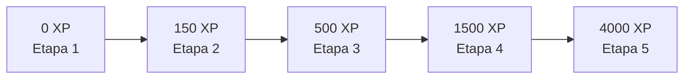
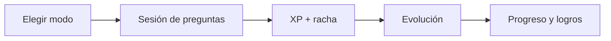



<i>Autoevaluación académica con mentores que evolucionan con vos.</i>

---

## Qué es

Una sola página (`HTML + Tailwind + JS`, sin build ni dependencias) para estudiar con sesiones tipo parcial, un mentor animado y progreso persistente en el navegador.

## Secciones

| | |
|---|---|
| ⌂ **Inicio** | Elegí modo secuencial o personalizado por fases |
| ❖ **Niveles** | Rango, XP y evolución de cada mentor |
| ◔ **Progreso** | Meta diaria, actividad y dominio por fase |
| ☷ **Historial** | Notas y sesiones anteriores |
| ✧ **Logros** | 18 hitos con barra de avance |
| 👔 **Armario** | 120 prendas, 12 diseños por categoría |

## Evolución por XP

| Mentor | Primera forma | Forma final |
|---|---|---|
| Dr. Alfred 🐧 | Polluelo Zen | Ascendido de la Aurora |
| Dr. Panino 🐕 | Cachorro de Cátedra | Cerbero Supremo |
| Dr. Chiquistriquis 🐈 | Gatito Travieso | Bakeneko Cósmico |
| Dr. Moyin 🦫 | Capi Cachorro | Capibara Celestial |

## Flujo

## Uso local

Abrí `kore_the_intellectual_sanctuary_ics.html` en el navegador. Los datos se guardan en `localStorage`.

## Deploy

Sitio estático. En Vercel: *Framework Preset* **Other**, sin build command. `vercel.json` sirve el HTML en `/`.

---

KORE · hecho con calma

